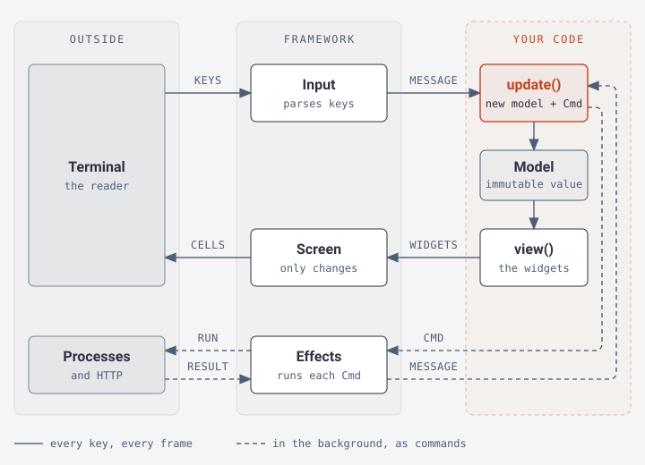

# Elmphant TUI

**Terminal user interfaces in PHP, built with The Elm Architecture.**

Inspired by Go's [Bubbletea](https://github.com/charmbracelet/bubbletea) and
Rust's [Ratatui](https://github.com/ratatui/ratatui). The name mixes the **PHP
elephant** and **Elm**.

- **Simple model.** Your app is an immutable value. A key press gives you a new
  value, and the framework draws it.
- **Widgets included.** Lists, tables, forms, tabs, trees, modals, dropdowns,
  search fields, progress bars and more, with keyboard and mouse support.
- **Text you can copy.** Drag over the text in a panel to copy it, even while
  the app reads the mouse. See [Copying text](guide/widgets.md#copying-text).
- **No blocking.** Processes, HTTP requests and timers run in the background and
  report back as messages.
- **Full screen or inline.** An app can take the whole screen, or ask its
  questions below the shell prompt and leave the answers in the scrollback. See
  [Drawing inline](guide/running.md#drawing-inline).
- **Easy to test.** Press keys and read the screen in a plain PHPUnit test, with
  no terminal.

PHP 8.2+ · MIT License

## Install

```bash
composer require elmphant/tui
```

You need PHP 8.2+ and `ext-mbstring`. Apps run in POSIX terminals (Linux, macOS,
WSL). Tests run anywhere.

Some features need an extra package. You only install it if you use the feature:

```bash
composer require symfony/http-client   # Cmd::http()
composer require league/commonmark     # Paragraph::fromMarkdown()
composer require amphp/http-client:^5  # HTTP inside Cmd::fiber(), with symfony/http-client
```

## A counter

```php
<?php

declare(strict_types=1);

require __DIR__ . '/vendor/autoload.php';

use Elmphant\Tui\Application\App;
use Elmphant\Tui\Core\{Cmd, UpdateResult};
use Elmphant\Tui\Layout\Rect;
use Elmphant\Tui\Message\KeyMsg;
use Elmphant\Tui\Runtime\Program;
use Elmphant\Tui\Widget\Prose\Text;
use Elmphant\Tui\Widget\Widget;

final readonly class Counter extends App
{
    public function __construct(private int $count = 0) {}

    public function view(): Widget
    {
        return Text::new("Count: {$this->count}  j/k change, x or Ctrl+Q quit");
    }

    protected function onKey(KeyMsg $message, Rect $screen): UpdateResult
    {
        return match ($message->key) {
            'k' => new UpdateResult($this->withCount($this->count + 1)),
            'j' => new UpdateResult($this->withCount($this->count - 1)),
            'x' => $this->then(Cmd::quit()),
            default => UpdateResult::ignored($this),
        };
    }

    private function withCount(int $count): self
    {
        return $count === $this->count ? $this : new self($count);
    }
}

Program::run(new Counter());
```

Save it as `counter.php` and run `php counter.php`.

## How it works

<picture>
  <source media="(max-width: 700px)" srcset="diagrams/overview-narrow.svg">
  
</picture>

1. Something happens: a key, a click, a timer, a finished process. It arrives as
   a **message**.
2. Your app answers with a **new model**, and maybe a **command** — a
   description of work to do, such as "run `git status`".
3. The framework draws `view()` of the new model and runs the command. When the
   command finishes, its result is the next message.

`update()` and `view()` never do the work themselves. That is why an app is easy
to test: a test checks which command was asked for, and nothing runs.
[How it works](guide/how-it-works.md) follows one key press through the framework.

## Guides

| Guide | What you learn |
| --- | --- |
| [Building an app](guide/apps.md) | The `App` class, its hooks, and how interactive widgets keep their state |
| [Widgets](guide/widgets.md) | Every built-in widget, plus forms, modals, tables and scrolling |
| [Layout](guide/layout.md) | Placing widgets side by side or stacked, and making them reflow |
| [Styling](guide/styling.md) | Themes, colours in text, what each widget reads, and styling one part of the screen |
| [Keys and focus](guide/keys-and-focus.md) | Shortcuts, typing into fields, vim mode, the key help, footer hints, and where the keyboard goes |
| [Commands and effects](guide/effects.md) | Timers, processes, HTTP, cancelling, and effects of your own |
| [Testing](guide/testing.md) | Driving an app or one widget from a test, and checking the screen |
| [Running and debugging](guide/running.md) | Program options, drawing inline, terminals, errors, tracing, debugging, and the PHPStan rules |
| [Custom widgets](guide/custom-widgets.md) | Writing your own widget, popups, and drawing cells by hand |
| [How it works](guide/how-it-works.md) | What the framework does between a key press and the screen, in four diagrams |

## License

MIT
