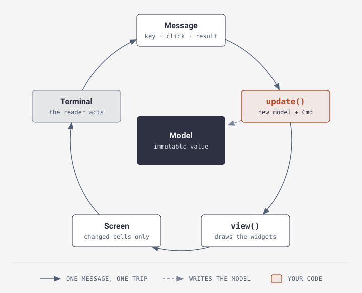
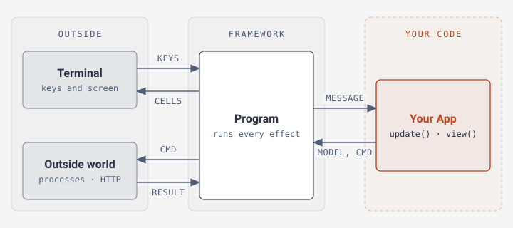
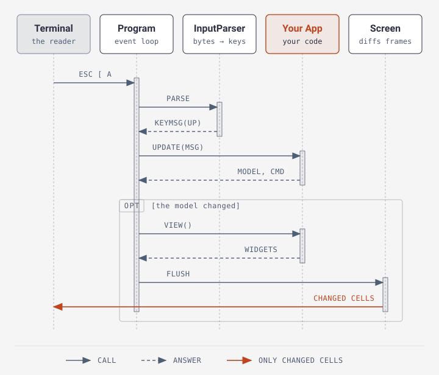
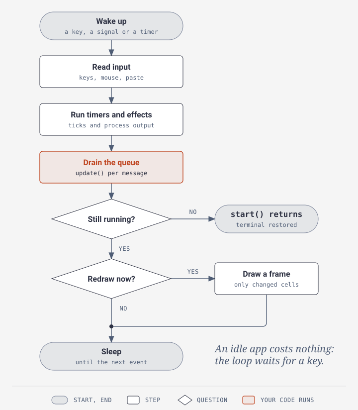

# How it works

[← README](../README.md)

You don't need this page to build an app. It shows what happens between a key
press and the screen, for when you want to know.

## The update cycle

<picture>
  <source media="(max-width: 700px)" srcset="../diagrams/update-cycle-narrow.svg">
  
</picture>

Every message makes one trip around the ring. `update()` is the only step that
makes a new model. If it returns the same model, nothing is redrawn.

## Your app and the framework

<picture>
  <source media="(max-width: 700px)" srcset="../diagrams/runtime-narrow.svg">
  
</picture>

Your app never touches the terminal, a process or the network. It returns a
command, which is plain data. `Program` runs it and sends the result back as a
message. See [Commands and effects](effects.md).

## One key press, start to finish

<picture>
  <source media="(max-width: 700px)" srcset="../diagrams/keystroke-narrow.svg">
  
</picture>

The terminal sends ↑ as three bytes, `ESC [ A`. `InputParser` turns them into a
`KeyMsg`, and your `update()` answers it. A frame is drawn only when the model
changed, so a key nothing reacts to costs nothing.

## One turn of the event loop

<picture>
  <source media="(max-width: 700px)" srcset="../diagrams/program-tick-narrow.svg">
  
</picture>

Everything that happened since the last turn becomes a message first. Only then
does your app see them, in order. At most one frame is drawn per turn, and never
more often than the frame rate allows (`Program::withFps()`).
