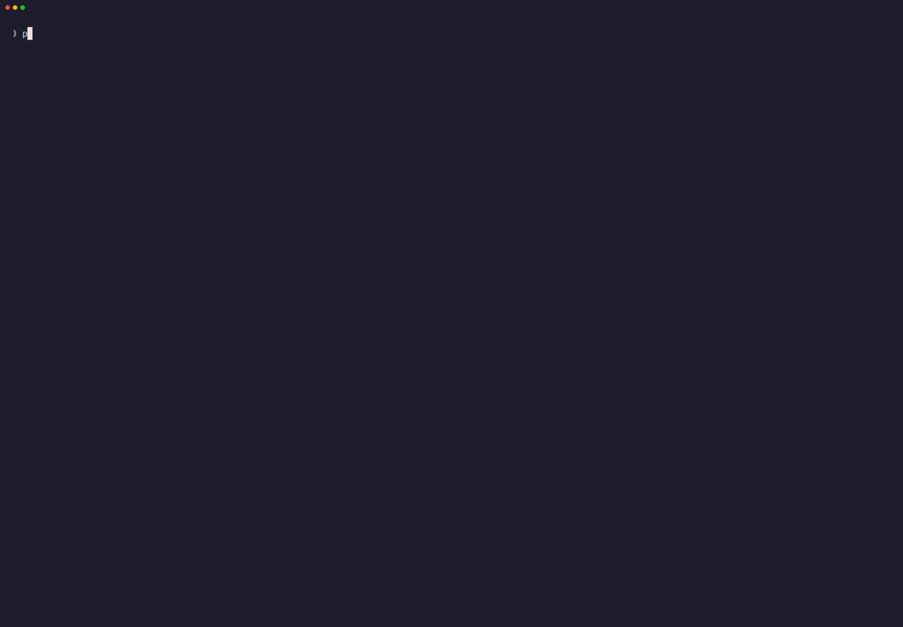
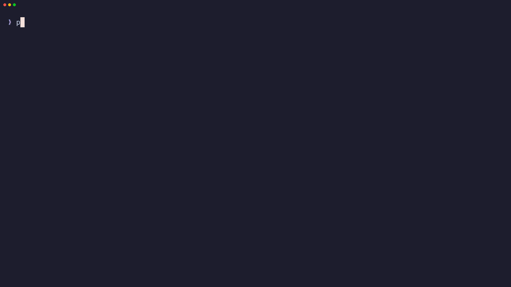
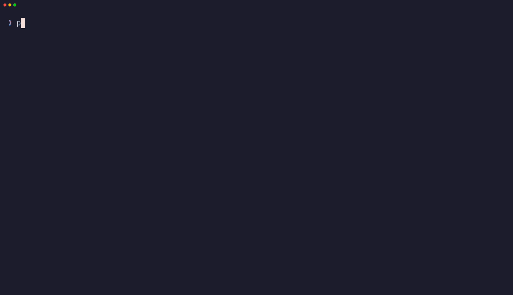
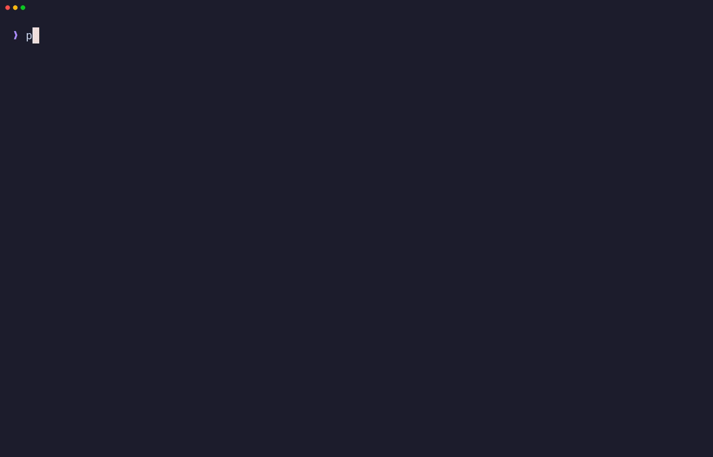
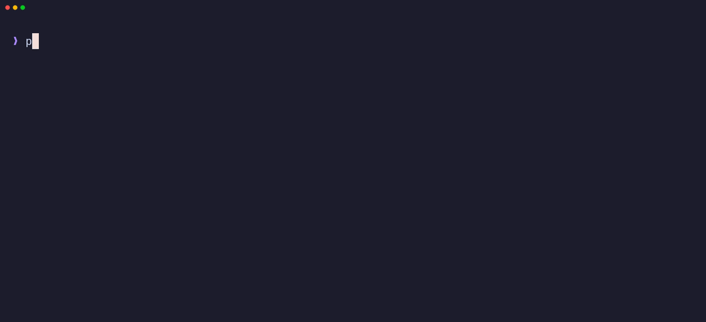

# Showcase

[← README](../README.md)

What apps built with Elmphant TUI look like. Every recording is a real app
running in a terminal, driven by the keyboard.

- [Widgets on one screen](#widgets-on-one-screen)
- [A kanban board](#a-kanban-board)
- [Dropdowns](#dropdowns)
- [A form](#a-form)
- [A form below the prompt](#a-form-below-the-prompt)
- [Questions one at a time](#questions-one-at-a-time)

## Widgets on one screen

Text fields, checkboxes, a table with section rows, a list, tabs, a package
list that arrives in the background, and the key help that `?` opens. Tab walks
from widget to widget.

Read more: [Widgets](widgets.md) · [Layout](layout.md) · [Keys and focus](keys-and-focus.md)

## A kanban board

A widget drawn by hand. Arrow keys move between cards, Enter moves a card to the
next column, and cards can be added and deleted. Dragging a card with the mouse
works too.

Read more: [Custom widgets](custom-widgets.md) · [Building an app](apps.md)

## Dropdowns

A `Dropdown` holds a `Select`, a `Radio`, a `CheckboxGroup` or a `FilterableList`
and floats its list over the screen. Ticking a checkbox keeps the list open,
choosing an option closes it, and typing narrows a filterable list.

Read more: [Widgets](widgets.md)

## A form

A `Form` of named fields. Submitting with a required field empty shows the
problem under it and sends the keyboard there.

Read more: [Forms](widgets.md#forms)

## A form below the prompt

The same kind of form, drawn inline: it takes only the rows it needs below the
shell prompt, and what it leaves stays in the scrollback.

Read more: [Drawing inline](running.md#drawing-inline)

## Questions one at a time

An inline app that asks one question, prints the answer above itself with
`Cmd::println()`, and asks the next.

Read more: [Drawing inline](running.md#drawing-inline) · [Commands and effects](effects.md)
